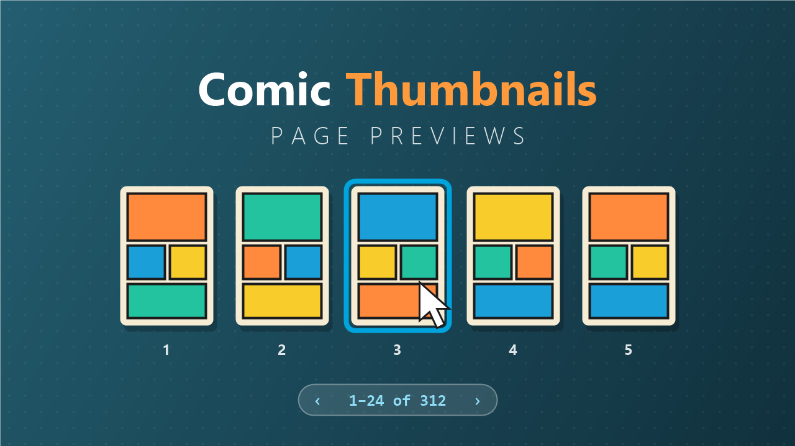
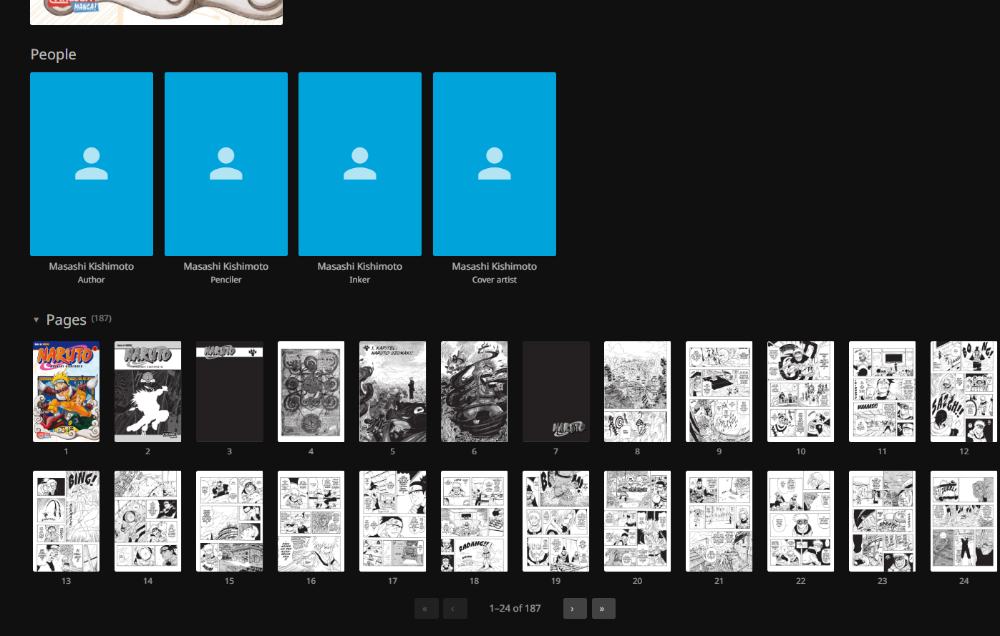

# Comic Thumbnails – Jellyfin Plugin



Adds a **Pages** section to the detail page of every comic in Jellyfin, right below the people (*Cast & Crew*). It shows a thumbnail of each page of the comic. Click a thumbnail and Jellyfin's comic reader opens at exactly that page.



- **Paged loading:** only one page of thumbnails (24 by default) is requested at a time. Use the arrows below the grid to page through large comics. Within a page, images load lazily as they scroll into view, at most four at a time.
- **Server-side cache:** thumbnails are resized once with Jellyfin's own image encoder (WebP, or JPEG as a fallback) and stored in Jellyfin's cache folder. When the comic file changes, its thumbnails are recreated.
- **Reading progress:** the pager starts on the page you last read, and that thumbnail is highlighted.
- **Formats:** `.cbz`, `.cbr`, `.cb7` and `.cbt`, the same archives the web reader opens.
- **Permissions:** the API respects library access and parental controls, just like the rest of Jellyfin.
- **Languages:** English and German labels, picked from the web client's language.

## Installing

Requires Jellyfin **12.2** or newer (the plugin targets ABI `12.2.0.0`, .NET 10).

### From the plugin repository (recommended)

Installing through the repository gives you the catalog entry and automatic update notices.

1. Open the Jellyfin dashboard and go to **Plugins → Repositories** (in some versions: *Catalog → gear icon*), then click **+**.
2. Enter any name (e.g. `Comic Thumbnails`) and this URL, then save:

   ```
   https://raw.githubusercontent.com/MoritzGrossmann/jellyfin-plugin-comic-thumbnails/master/manifest.json
   ```

   Want pre-releases too? Use `manifest-beta.json` instead of `manifest.json`.
3. Open the **Catalog** tab, find **Comic Thumbnails** under *General* and click **Install**.
4. Restart Jellyfin. The plugin must show the status **Active** under *Dashboard → Plugins*.
5. Reload the web client in your browser (Ctrl+F5), so it picks up the new script.
6. Open a comic. The **Pages** section appears below the people.

**Updating:** new releases appear in the catalog (and under *Dashboard → Plugins*) automatically. Install the update, restart Jellyfin and reload the browser.

**Plugin not listed or "unsupported"?** The server version must be at least the plugin's `targetAbi` (12.2.0.0). Older servers do not show or load it.

### Manual

Download the ZIP from the [latest release](https://github.com/MoritzGrossmann/jellyfin-plugin-comic-thumbnails/releases) and extract it into the server's plugin folder, in a subfolder named `Comic Thumbnails_<version>`. The ZIP contains `Jellyfin.Plugin.ComicThumbnails.dll` and `SharpCompress.dll`; both are needed.

- Windows (installer/service): `C:\ProgramData\Jellyfin\Server\plugins\Comic Thumbnails_<version>\`
- Linux package: `/var/lib/jellyfin/plugins/Comic Thumbnails_<version>/`
- Docker: `/config/plugins/Comic Thumbnails_<version>/`

Then restart Jellyfin and continue with step 4 above.

## Settings

*Dashboard → Plugins → Comic Thumbnails*

| Setting | Default | Meaning |
|---|---|---|
| Add the thumbnail section to the web client | on | Adds the client script to the web client (see below). |
| Start collapsed | off | The section is collapsed until you click its title. |
| Thumbnails per page | 24 | Page size of the pager, 6 to 200. |
| Thumbnail width | 240 px | Width of the generated thumbnails, 80 to 800. |
| Thumbnail quality | 80 | Encoder quality, 1 to 100. |

**Clear thumbnail cache** deletes all generated thumbnails. They are recreated when needed.

## How it works

### Web client

Jellyfin has no official way for plugins to extend the web client's pages. The plugin therefore adds one `<script>` tag to the web client's `index.html` **while the page is served** (an ASP.NET Core middleware registered through `IStartupFilter`). No file on disk is changed, so this also works with read-only installs such as Docker images, and survives server updates.

The script watches for the item detail page. For items of type *Book* it asks the plugin for the page list; if the item is a supported comic archive it renders the section right after `#castCollapsible` (the people), or at the end of the page if that element does not exist.

If you already inject scripts another way (e.g. with a "Custom JavaScript" plugin or a reverse proxy), turn off **Add the thumbnail section to the web client** and load the script yourself:

```html
<script defer src="../ComicThumbnails/ClientScript"></script>
```

Clients that do not use the web client (e.g. native TV apps) do not show the section. Jellyfin Media Player and the mobile apps that wrap the web client do.

### Jumping to a page

Jellyfin's comic reader (part of jellyfin-web) takes its start page from `startPositionTicks / 10000`. The web client opens the reader when it receives a *Play* command, the same message the server sends when another device remote-controls it. The script hands a *PlayNow* command with `StartPositionTicks = page × 10000` directly to the web client's own handler for that message. No request goes to the server, so this also works in the Android app, where the server may deliver such commands to the app's native connection instead of the web view.

If the web client's internals are not found (for example after a larger web client update), the script falls back to asking the server to send the command to its own session (`POST /Sessions/{id}/Playing`).

### Page order

The reader extracts the archive in the browser, keeps files with an image extension (`jpg`, `jpeg`, `jpe`, `jif`, `jfif`, `jfi`, `png`, `avif`, `gif`, `bmp`, `dib`, `tiff`, `tif`, `webp`) and sorts them by file name (ordinal, without folders). The plugin uses the same rules, so thumbnail *N* is always reader page *N*.

### API

| Endpoint | Auth | Description |
|---|---|---|
| `GET /ComicThumbnails/{itemId}/Pages?startIndex=0&limit=24` | user | Page list, one pager page at a time. `limit` defaults to the configured page size. `TotalCount` is `0` for items that are not comic archives. |
| `GET /ComicThumbnails/{itemId}/Pages/{index}/Thumbnail` | user | Thumbnail of a page (zero-based index). |
| `DELETE /ComicThumbnails/Cache` | admin | Deletes all cached thumbnails. |
| `GET /ComicThumbnails/ClientScript` | none | The web client script. |

## Building

Requirement: Docker. No local .NET installation needed.

Windows (PowerShell, Docker Desktop):

```powershell
.\build.ps1                            # against Jellyfin 12.2.0
.\build.ps1 -JellyfinVersion 12.4.0    # against a different server version
```

Linux/macOS:

```sh
./build.sh                          # against Jellyfin 12.2.0
JELLYFIN_VERSION=12.4.0 ./build.sh  # against a different server version
```

**The build version must match the server or be older.** Jellyfin does not load a plugin whose `targetAbi` is higher than the server's version; it then shows up as unsupported under *Dashboard → Plugins*.

Result: `dist/comic-thumbnails_<version>.zip` containing the two DLLs and `meta.json`. The version is read from `build.yaml`. The script runs the unit tests first.

With a local .NET 10 SDK you can also run:

```sh
dotnet test
dotnet publish Jellyfin.Plugin.ComicThumbnails -c Release -o out
```

The NuGet version of `Jellyfin.Controller`/`Jellyfin.Model` must match the server version (`JellyfinVersion` in `Directory.Build.props`), and so must `targetAbi` in `build.yaml`.

## Versioning and releases

The version has four parts, as Jellyfin requires: `MAJOR.MINOR.PATCH.REVISION`.

| Part | Meaning |
|---|---|
| `MAJOR.MINOR.PATCH` | [Semantic Versioning](https://semver.org): breaking change / new feature / bug fix |
| `REVISION` | `0` = stable release, `1` and up = beta toward the next stable version |

`build.yaml` is the single source of truth: the assembly version, `meta.json` and the repository manifest all derive from its `version` and `changelog`.

Channels:

- **Stable** (`manifest.json`): a normal GitHub Release with revision `.0`, e.g. `v1.0.0.0`.
- **Beta** (`manifest-beta.json`): a GitHub *pre-release* with a non-zero revision, e.g. `v1.1.0.1`. The beta manifest also contains all stable releases.

To publish a release:

1. In `build.yaml`, set `version` (e.g. `"1.0.0.0"`) and describe the changes in `changelog`. Commit and push to `master`.
2. On GitHub, create a release with the tag `v<version>` (e.g. `v1.0.0.0`). Tick *Set as a pre-release* for betas.
3. The `build` workflow then tests and packages the plugin, attaches `comic-thumbnails_<version>.zip` to the release and commits the updated manifest(s) to `master`.

The workflow fails early if the tag does not match `build.yaml` or if the revision does not fit the channel (stable must end in `.0`, pre-releases must not). When you raise `JellyfinVersion` for a new server version, update `targetAbi` in `build.yaml`, `JELLYFIN_VERSION` in `scripts/package.sh`, `build.sh`, `build.ps1` and `.github/workflows/build.yaml` as well.

## Limitations

- Only the web client (and apps that embed it) shows the section.
- The section depends on the structure of jellyfin-web's detail page (`.itemDetailPage`, `#castCollapsible`). If a future web client changes it, the section falls back to the end of the page or may need an update.
- Solid `.cb7`/`.cbr` archives can only be read front to back, so the first thumbnails of late pages take longer. After that they come from the cache.
- PDF and EPUB books are not supported; they use different readers.
- Old thumbnails of deleted comics stay in the cache until you clear it.
